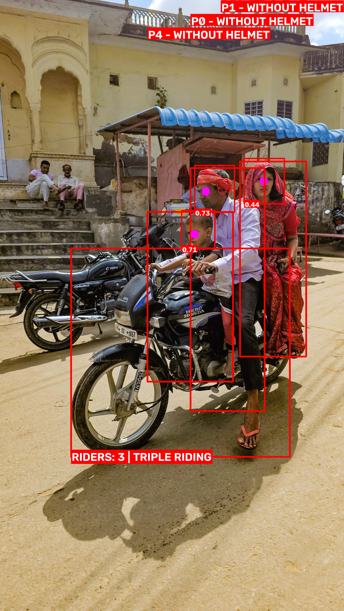
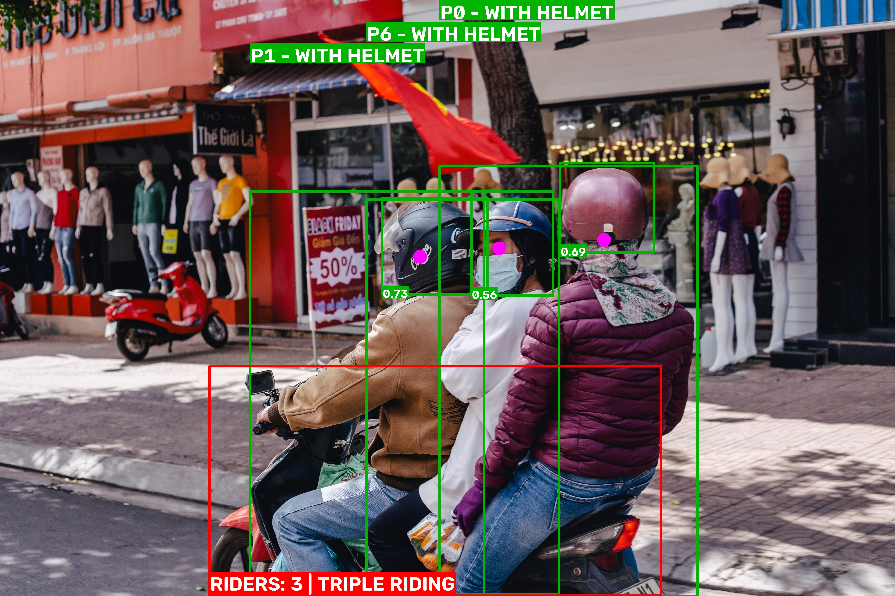
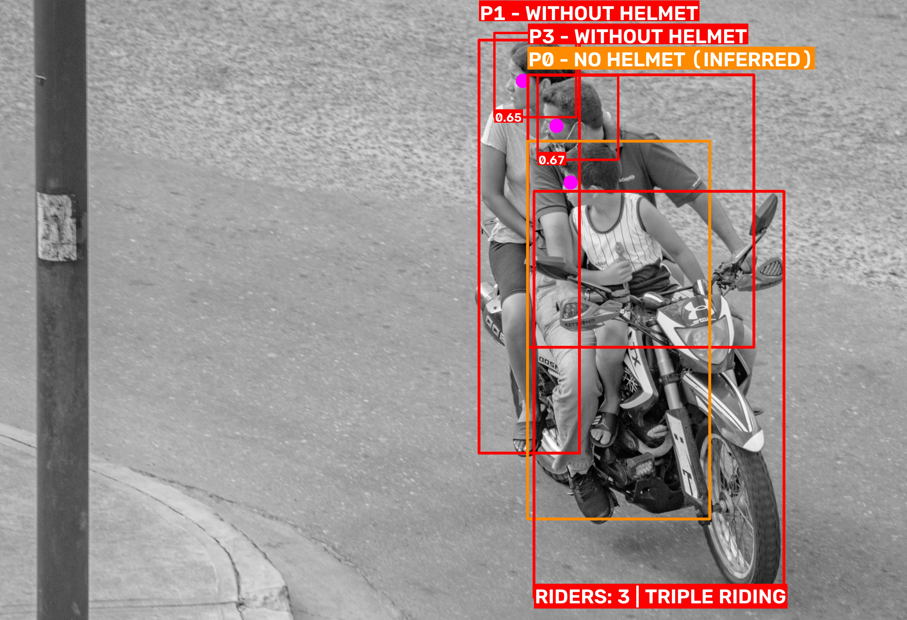

# Two-Wheeler Safety Violation Detection System

## Project Overview

The **Two-Wheeler Safety Violation Detection System** is a computer vision project designed to detect common two-wheeler safety violations using YOLO object detection models.

The system analyses images and videos to identify motorcycles, riders, helmet usage, and multiple riders on a motorcycle.

It aims to help identify unsafe riding behaviour and improve awareness of road safety.

## Objectives

- Detect motorcycles and people in images and videos.
- Identify riders wearing helmets and those without helmets.
- Count the number of riders on a motorcycle.
- Detect triple riding (three or more riders).
- Display visual warnings for detected safety violations.
- Save annotated images, videos, and evidence.

## Technologies Used

- Python
- OpenCV
- Ultralytics YOLO
- YOLO11n
- YOLO11n-Pose
- Custom-trained YOLO helmet detection model
- Visual Studio Code

## Main Features

### 1. Helmet Detection
Identifies whether a rider is wearing a helmet or not.

### 2. Rider Detection
Detects people and associates them with motorcycles using object detection and pose information.

### 3. Triple-Riding Detection
Counts riders associated with a motorcycle and flags cases involving three or more riders.

### 4. Photo Testing
Allows users to select an image and analyse it for safety violations.

### 5. Video Testing
Processes video files and displays detection results with visual annotations.

### 6. Output and Evidence
Saves annotated images and processed videos for reviewing detection results.

## Project Structure

```text
two-wheeler-safety/
│
├── data/
│   ├── helmet_dataset/
│   ├── test_images/
│   └── videos/
│
├── models/
│   └── helmet_detector.pt
│
├── outputs/
│   ├── evidence/
│   └── videos/
│
├── runs/
│   ├── test_images/
│   └── videos/
│
├── src/
│   ├── detect_video.py
│   ├── rider_association.py
│   ├── test_riders.py
│   ├── test_yolo.py
│   └── train_helmet.py
│
├── eval/
├── requirements.txt
├── README.md
├── yolo11n.pt
└── yolo11n-pose.pt
```

## Helmet Detection Model

A custom helmet detection model was trained using a YOLO-compatible dataset.

**Training configuration:**
- Model: YOLO11n
- Epochs: 30
- Image size: 640
- Batch size: 16
- Training platform: Google Colab with GPU

**Dataset classes:**
- With Helmet
- Without Helmet

### Model Evaluation Results

| Metric | Validation | Test |
|---|---:|---:|
| Precision | 0.904 | 0.899 |
| Recall | 0.842 | 0.821 |
| mAP50 | 0.927 | 0.919 |
| mAP50-95 | 0.593 | 0.582 |

## Testing

The system was tested using multiple images and video files.

Testing included:
- Riders wearing helmets.
- Riders without helmets.
- Multiple riders on one motorcycle.
- Triple-riding scenarios.
- Traffic videos with multiple motorcycles.

The photo and video tests produced correct results in the tested cases, based on visual verification.

## How to Run

### 1. Clone the repository

```bash
git clone YOUR_GITHUB_REPOSITORY_URL
cd two-wheeler-safety
```

### 2. Create a virtual environment

```bash
python -m venv venv
```

### 3. Activate the environment (Windows PowerShell)

```powershell
.\venv\Scripts\Activate.ps1
```

### 4. Install dependencies

```bash
pip install -r requirements.txt
```

### 5. Run the detection system

```bash
python src/test_riders.py
```

Select Photo Testing or Video Testing from the main menu.

## Limitations

- Detection accuracy can vary depending on image quality, lighting, camera angle, and occlusion.
- Rider-to-motorcycle association may be challenging in crowded traffic scenes.
- Low-confidence helmet detections may require further review.
- The system is a prototype and should not be treated as an official law-enforcement system.

## Future Improvements

- Improve rider-to-motorcycle association.
- Add object tracking across video frames.
- Improve helmet detection in crowded scenes.
- Develop a real-time camera-based monitoring interface.
- Build a dashboard for detection statistics and reports.

## Conclusion

This project demonstrates how computer vision and YOLO object detection can be used to identify two-wheeler safety violations, including helmet-related violations and triple riding.

It combines object detection, pose estimation, rider association, image processing, and video analysis into one system.

## Detection Results

### Double-Rider Detection


### Triple-Riding and Helmet Detection

**Test 1**



**Test 2**



**Test 3**

