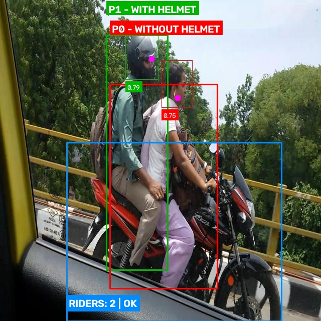

# Two-Wheeler Safety Violation Detection

Computer-vision system that watches photos, videos and live cameras and flags two common
two-wheeler safety violations:

- **Riding without a helmet**
- **Triple riding** (three or more people on one motorcycle)

Every violation is saved as an annotated evidence image and a database record, and the
number plate of the offending motorcycle can be read automatically.

> **Prototype.** Built for learning and demonstration. It is not an official
> law-enforcement system; see [Responsible use](#responsible-use).


## Features

| | |
|---|---|
| **Detection** | Motorcycles (YOLO11), riders (YOLO11-Pose), helmets (custom-trained YOLO11n) |
| **Tracking** | ByteTrack gives every motorcycle a stable ID, so one violator is counted once |
| **Rider counting** | Each person is assigned to a bike by their seat (hip) position; hidden pillions are recovered from head detections |
| **Smoothing** | Rider counts use a median over recent frames, so one bad frame cannot trigger a violation |
| **Number plates** | Optional plate detector + EasyOCR with Indian plate-format correction |
| **Evidence** | Annotated image per violation, with a cool-down so the same bike is not saved repeatedly |
| **Database** | SQLite log of every violation (`outputs/violations.db`), exportable to CSV |
| **Inputs** | Video file, photo(s), webcam, CCTV / RTSP stream, phone camera (IP-camera app) |
| **Interfaces** | Streamlit dashboard, command-line tools, interactive photo tester |

## Quick start

Requires **Python 3.10+**. An NVIDIA GPU is optional but makes video much faster.

```bash
git clone https://github.com/khushi-149/two-wheeler-safety-detection.git
cd two-wheeler-safety-detection

python -m venv venv
# Windows PowerShell:  .\venv\Scripts\Activate.ps1
# macOS / Linux:       source venv/bin/activate

pip install -r requirements.txt
```

Download **`helmet_detector.pt`** from this repository's *Releases* page and put it in
`models/`. Official YOLO weights (`yolo11n.pt`, `yolo11n-pose.pt`) download automatically on
first use. Then verify the setup:

```bash
python scripts/check_setup.py
```

## Usage

### Dashboard (recommended)

```bash
streamlit run src/dashboard.py
```

Pick an input source in the sidebar, press **Start**, and watch live counters and violations.
The **Results** tab shows the processed video/photo, violations, plates and evidence for each
run; **History** lists everything ever logged and exports CSV.

### Command line

```bash
python src/detect_video_full.py                      # menu of videos in data/videos
python src/detect_video_full.py clip.mp4 photo.jpg   # process specific files
python src/detect_video_full.py clip.mp4 --no-preview --no-plates   # fastest
python src/detect_webcam.py 0 --record               # webcam 0, save the annotated video
python src/detect_webcam.py "http://192.168.1.5:8080/video"   # phone / IP camera
```

Add `-v` for detailed progress logging. Press **Q** in a preview window to stop.

### Interactive photo tester

```bash
python src/interactive_tester.py
```

Menu-driven tool for single photos in `data/test_images/` using a heavier full-frame method
with extra helmet re-checks. You can enter the expected rider count to compare with the result.

### Train the helmet model

```bash
python src/train_helmet.py --epochs 30 --device 0
```

Or run `notebooks/helmet_detection_training.ipynb` on Google Colab. See `data/README.md` for the dataset.

### Train the number-plate detector (needed for plate reading)

Plate reading stays off until `models/plate_detector.pt` exists. Train it on Google Colab with
`notebooks/plate_detection_training.ipynb`: download a licence-plate dataset from Roboflow Universe
(YOLOv8 format, check its licence), upload the zip in the notebook, run all cells, and copy the
downloaded `plate_detector.pt` into `models/`. Plates are only read for bikes with a violation.

## Project structure

```text
two-wheeler-safety-detection/
├── src/
│   ├── settings.py            all thresholds and folder locations (edit here)
│   ├── pipeline.py            main pipeline: track -> riders -> helmets -> plates -> evidence
│   ├── assignment.py          which person rides which bike, which head belongs to whom
│   ├── rider_association.py   full-frame association, duplicate removal, triple-riding rule
│   ├── rider_tracking.py      ByteTrack wrapper for motorcycles
│   ├── plate_reader.py        plate detection + OCR + background worker
│   ├── violation_db.py        SQLite violation log
│   ├── capture.py             photo / camera / stream input
│   ├── drawing.py             annotation helpers
│   ├── geometry.py            box maths (IoU, centres, ...)
│   ├── stream_server.py       local MJPEG server for smooth live view in the dashboard
│   ├── video_menu.py          video / camera pickers
│   ├── dashboard.py           Streamlit app
│   ├── detect_video_full.py   CLI: videos and photos
│   ├── detect_webcam.py       CLI: webcam and streams
│   ├── interactive_tester.py  menu-driven photo / video tester
│   └── train_helmet.py        CLI: train the helmet detector (also works for other YOLO datasets)
├── tests/                     automated tests (pytest)
├── scripts/check_setup.py     environment diagnostics
├── notebooks/                 Colab notebooks: helmet and number-plate training
├── models/                    model weights (not in git)
├── data/                      videos, photos, dataset (not in git)
├── outputs/                   evidence, processed videos, plates, database (not in git)
├── eval/                      helmet model evaluation plots
└── screenshots/               example results
```

## How it works

1. **Track** motorcycles with YOLO11 + ByteTrack, so each bike keeps one ID.
2. **Crop** the area around each bike (including the space above it where riders sit).
3. **Detect** people with pose estimation and heads with the helmet model on that crop.
4. **Assign** each person to the bike their hips are on; assign each head to its rider;
   treat a head with no body above a bike as a hidden pillion.
5. **Smooth** the rider count over the last few analyses of that bike.
6. **Decide**: any *Without Helmet* head -> helmet violation; 3+ riders -> triple riding.
7. **Record**: save the annotated frame, log it in SQLite, and read the plate in a background
   thread so the video never stalls.

To keep video fast, each bike is re-analysed every 3rd frame while tracking runs on every frame.
All of this is tunable in `src/settings.py`.

## Output

| Location | Content |
|---|---|
| `outputs/evidence/` | Annotated frame for each violation |
| `outputs/videos/` | Annotated videos |
| `outputs/images/` | Annotated photos |
| `outputs/plates/` | Cropped number plates |
| `outputs/violations.db` | SQLite table `violations` (run, bike ID, type, time, evidence path, plate) |

## Helmet model

Custom YOLO11n trained on Google Colab (30 epochs, 640 px, batch 16) on the Roboflow
*Helmet Detection_YOLOv8 - With and Without Helmet* dataset (4,169 images, CC BY 4.0; see
`data/README.md`). Classes: **With Helmet**, **Without Helmet**.

| Metric | Validation | Test |
|---|---:|---:|
| Precision | 0.904 | 0.899 |
| Recall | 0.842 | 0.821 |
| mAP50 | 0.927 | 0.919 |
| mAP50-95 | 0.593 | 0.582 |

Confusion matrix, PR/F1 curves and sample predictions are in `eval/helmet_evaluation/`.

## Testing

```bash
pip install -r requirements-dev.txt
pytest
```

The tests run without GPU, model weights or PyTorch: they use scripted stand-in models and
real image / video files to check rider counting, smoothing, evidence saving, the database,
plate-text correction and credential redaction end to end. They also run in CI on every push.

Beyond the automated tests, the system was checked visually on photos and traffic videos
covering helmeted riders, riders without helmets, double riding, triple riding and busy
multi-motorcycle scenes.

## Configuration

Everything tunable is in `src/settings.py`: confidence thresholds, evidence cool-down,
analysis frequency, rider-assignment margins, and folder locations. Paths are relative to the
project root, so scripts work from any directory.

## Limitations

- Accuracy depends on image quality, lighting, camera angle and occlusion.
- Rider assignment is harder in dense traffic where bikes overlap.
- Helmet detections of low confidence may need human review.
- Plate reading needs a separate plate-detector model (`models/plate_detector.pt`); without it
  plate reading is switched off.
- The dashboard shares one set of models between sessions, so run one analysis at a time.

## Troubleshooting

| Problem | Fix |
|---|---|
| `Helmet model not found` | Put `helmet_detector.pt` in `models/` (see `models/README.md`) |
| `Missing dependency` | `pip install -r requirements.txt` |
| No preview window / OpenCV GUI error | You have a headless OpenCV build; the program continues without a window |
| Webcam not found | Close other apps using it, or try another index (`python src/detect_webcam.py 1`) |
| Processed video does not play in the dashboard | `pip install imageio-ffmpeg`, or open the file from `outputs/videos/` |
| Very slow on CPU | Use `--no-preview --no-plates`, or raise `ANALYZE_EVERY` in `settings.py` |

## Responsible use

This project processes video of real people and can store images and number plates, which are
personal data. Use it only where you have the right to record, follow your local privacy and
traffic laws, keep evidence only as long as needed, and have a human review any detection
before it is acted on. Detections are statistical and can be wrong.

## Results gallery

**Double riding**



**Triple riding with helmet detection**


## Acknowledgements

[Ultralytics YOLO](https://github.com/ultralytics/ultralytics) - detection, pose, tracking ·
[EasyOCR](https://github.com/JaidedAI/EasyOCR) - plate text ·
[Streamlit](https://streamlit.io) - dashboard ·
Helmet dataset by *learning-evidence* on [Roboflow Universe](https://universe.roboflow.com/learning-evidence/helmet-detection_yolov8) (CC BY 4.0).